# Parcial II - Manejo de las Estructuras de Datos


## Estructura de carpetas

- `main.py`: implementación de los literales A, B, C y D.
- `README.md`: documentación del proyecto.

## Cómo correr el proyecto

Con Python:

```bash
python main.py
```

## Cambios realizados

En el archivo `main.py` se implementaron los literales A y B:

- Literal A: cola FIFO para registrar solicitudes `P001`, `P002` y `P003`, atenderlas en orden y mostrar las solicitudes pendientes.
- Literal B: pila LIFO para registrar los despachos `D001`, `D002` y `D003`, consultarlos y retirar el último despacho registrado.
- Se agregaron controles para intentar atender solicitudes o retirar despachos cuando las estructuras están vacías.

También se implementaron:

- Literal C: árbol binario de búsqueda con inserción, búsqueda, recorrido inorden y eliminación.
- Literal D: menú de consola, validación de entradas, demostración integrada y pruebas básicas.

## Evidencias

Las siguientes capturas muestran el funcionamiento del programa y se encuentran en la carpeta `docs`.

### Menú y estructuras FIFO/LIFO

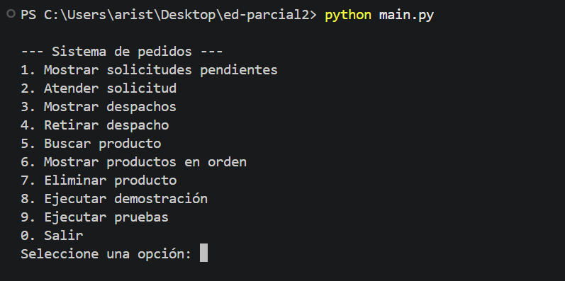

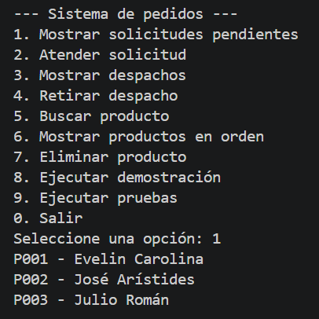

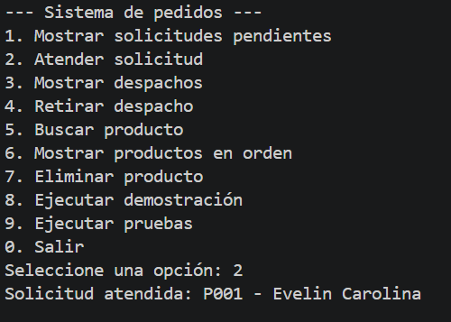

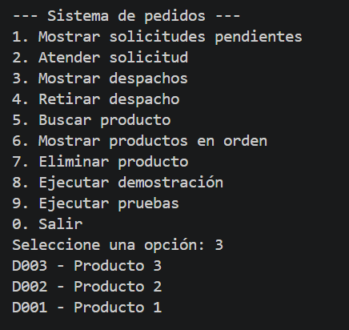

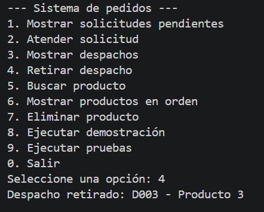

### Árbol binario de búsqueda

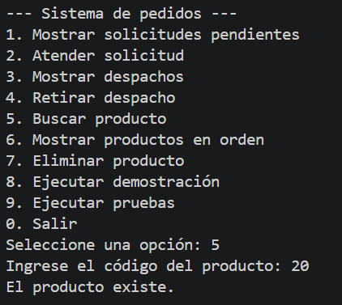

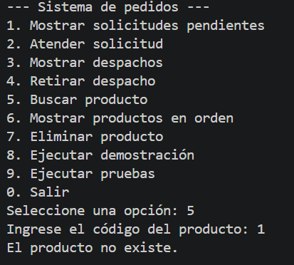

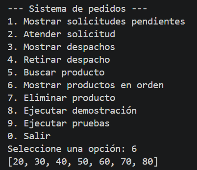

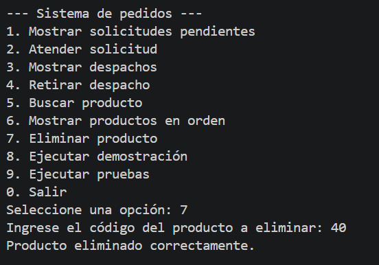

### Integración, validaciones y pruebas

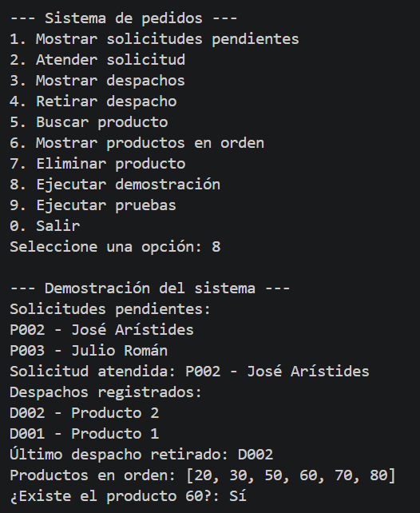

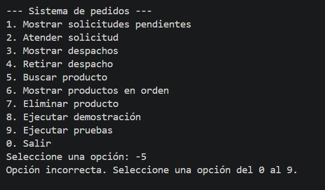

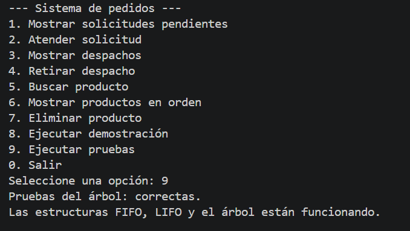

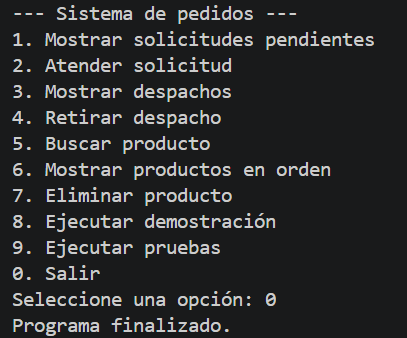
